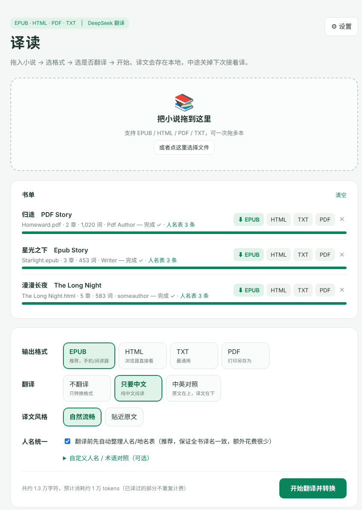

# 译读 · 电子书格式转换 + DeepSeek 中文翻译

一个 Chrome / Edge 浏览器插件：把英文小说（比如从 AO3 下载的同人）拖进去，转换成 EPUB / HTML / TXT / PDF，并可以用 DeepSeek 翻译成**纯中文**或**中英对照**。

- 支持读入：EPUB、HTML（能识别 AO3 下载格式）、TXT、文字版 PDF
- 支持导出：EPUB 3、单文件 HTML、TXT、PDF（打印另存为）
- 自动整理人名表，全书译名统一，也可以自己补充译名
- 断点续译：中途停止或关掉页面，下次接着译，已译部分不重复计费
- 斜体、粗体、分隔线、作者注都会保留
- 所有处理都在你自己的浏览器里完成，不经过任何第三方服务器
- 很多作者明确表示，不希望自己的作品被交给 AI 处理。请在使用翻译功能前先看看作者的说明（作者注、个人简介里常有相关声明）；作者不同意的，请不要翻译。
翻译结果只供自己阅读，不要发布、转载或用来训练任何东西。

> **插件本身免费，但不带 API Key。** 想用翻译功能需要你自己去 DeepSeek 申请 Key，费用按用量算在你自己的账户上（一篇 10 万词的长篇大约 1～3 元人民币）。只转换格式不需要 Key。

## 安装

1. 在本页右侧点 **Releases**，下载最新版的 `EasyRead-x.x.zip` 并解压。
   （或者点绿色的 **Code → Download ZIP**。）
   所有文件名都是英文，Windows 自带解压也不会乱码。
2. 浏览器地址栏打开 `chrome://extensions`（Edge 打开 `edge://extensions`）。
3. 打开“开发者模式” → 点“加载已解压的扩展程序” → 选择解压出来的 **`extension`** 文件夹。
4. 点工具栏的拼图图标，把“译读”固定到工具栏。

解压后也可以双击 `INSTALL.html`，里面有图文步骤和“复制文件夹路径”按钮。

## 填写你自己的 DeepSeek API Key

1. 打开 [platform.deepseek.com](https://platform.deepseek.com)，注册并充值少量金额（10 元能用很久）。
2. 左侧 **API keys → 创建 API key**，复制 `sk-` 开头的字符串（只显示一次）。
3. 点工具栏的“译读”图标 → 右上角 **⚙ 设置** → 粘贴 Key → **检测连接** → **保存设置**。

Key 只保存在你自己电脑的浏览器里，插件只会把它发给 `api.deepseek.com`。**不要把 Key 发给别人，也不要贴到 Issue 或截图里。** 如果不小心泄露了，到 DeepSeek 后台把它删掉再新建一个就行。

更多说明见 [DEEPSEEK.md](DEEPSEEK.md)。

## 使用

1. 把小说文件拖进虚线框（可以一次拖多本）。
2. 选输出格式和翻译方式（不翻译 / 只要中文 / 中英对照）。
3. 点“开始”，完成后会自动下载。

完整说明和常见问题见 [USAGE.md](USAGE.md)。

## 注意

- 不支持 MOBI / AZW3 和扫描版 PDF。AO3 下载时选 EPUB 或 HTML 效果最好。
- DeepSeek 可能会因为内容审核拒绝翻译个别段落，这些段落会保留英文原文，整本书照常完成。
- 请尊重原作者：翻译版仅供个人阅读，不要再上传或分发。

## 许可证

本项目以 [MIT License](LICENSE) 开源。用到的第三方库见 [THIRD_PARTY_NOTICES.md](THIRD_PARTY_NOTICES.md)。
